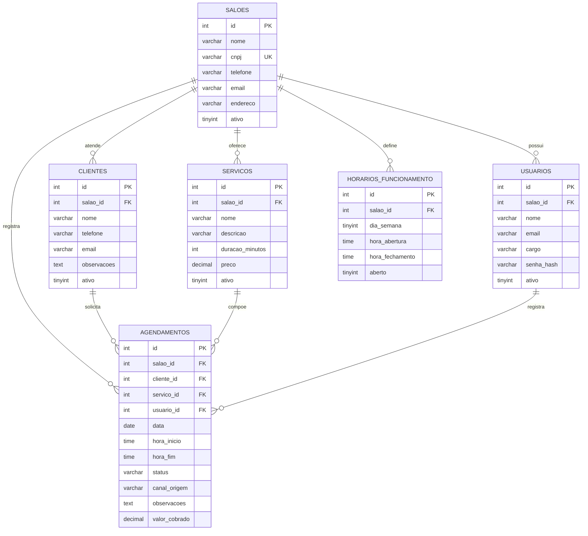

# Arquitetura em 3 Camadas e Modelo de Dados SaaS — BeautySchedule

## 1. Arquitetura em 3 Camadas

O **BeautySchedule** foi estruturado respeitando rigorosamente a separação de responsabilidades em **3 camadas**:

1. **Camada de Apresentação (`frontend/` e `backend/app/routers/`)**:
   - Interface Web em HTML5, CSS3 e JavaScript (`frontend/index.html`, `frontend/css/styles.css`, `frontend/js/api.js`, `frontend/js/app.js`).
   - Controladores HTTP/REST implementados com `APIRouter` do FastAPI (`backend/app/routers/`), responsáveis apenas por receber requisições, validar formatos de entrada via schemas Pydantic e delegar o processamento aos serviços de domínio.
2. **Camada de Aplicação / Regras de Negócio (`backend/app/services/` e `backend/app/schemas.py`)**:
   - Contém todas as regras de domínio:
     - Isolamento multi-tenant (`TenantContext` em `backend/app/dependencies.py`).
     - Validação de expediente do salão por dia da semana (`horarios_funcionamento`).
     - Cálculo automático de horário de término (`hora_fim = hora_inicio + duracao_minutos`).
     - Detecção e bloqueio de conflitos de horários na agenda (`hora_inicio < existente_fim AND hora_fim > existente_inicio`).
     - Regras de transição de status (`AGENDADO`, `CONFIRMADO`, `CONCLUIDO`, `CANCELADO`), reagendamento e inativação lógica de clientes e serviços.
3. **Camada de Persistência / Dados (`backend/app/repositories/` e `database/`)**:
   - Repositórios SQL parametrizados (`SalaoRepository`, `ClienteRepository`, `ServicoRepository`, `AgendamentoRepository`) e scripts DDL/DML para **MySQL 8.4**.

---

## 2. Isolamento Multi-Tenant (Conceito SaaS)

Para atender múltiplos salões de beleza na mesma infraestrutura sem vazamento de dados entre clientes do SaaS:

1. **Discriminador `salao_id` em todas as tabelas de negócio**: `usuarios`, `clientes`, `servicos`, `horarios_funcionamento` e `agendamentos` possuem `salao_id NOT NULL`.
2. **Integridade Referencial Composta no SGBD**:
   - As tabelas `clientes`, `servicos` e `usuarios` declaram chaves únicas compostas `(id, salao_id)`.
   - A tabela `agendamentos` declara chaves estrangeiras compostas:
     - `FOREIGN KEY (cliente_id, salao_id) REFERENCES clientes (id, salao_id)`
     - `FOREIGN KEY (servico_id, salao_id) REFERENCES servicos (id, salao_id)`
     - `FOREIGN KEY (usuario_id, salao_id) REFERENCES usuarios (id, salao_id)`
   - Isso impede, inclusive no nível do banco de dados MySQL 8.4, que um agendamento do Salão 1 referencie um cliente ou serviço pertencente ao Salão 2.
3. **Resolução de `salao_id` Exclusivamente no Servidor**:
   - Os schemas de entrada (`ClienteCreate`, `ServicoCreate`, `AgendamentoCreate`, etc.) utilizam `ConfigDict(extra="forbid")` e **não aceitam `salao_id` enviado pelo frontend**.
   - Se uma requisição maliciosa tentar injetar `"salao_id": 2` no JSON, a API rejeita imediatamente com `HTTP 422 Unprocessable Entity`.

---

## 3. Diagrama Entidade-Relacionamento (DER)

